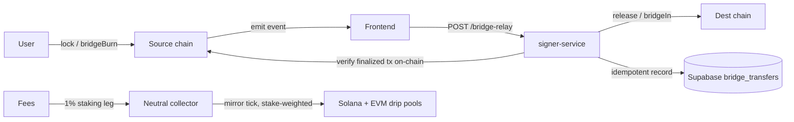

# NAVE Bridge & Staking — End-to-End Analysis, Security Audit & Cost Estimate

Status: Complete (test-hardening + audit deliverable, not a mainnet deployment)
Scope: Cross-chain bridge (Solana + Ethereum + Base) and staking/rewards system
Repos: `nave-contracts` (Solana `solana/`, EVM `evm/`) and `nave-app` (`src/`, `signer-service/`)

---

## 1. Executive summary

The NAVE bridge and staking systems were audited end-to-end from four angles in parallel: contract test-hardening, relayer/signer-service integration testing, professional UX/UI review, and an adversarial penetration-test + mainnet cost estimate. The systems are architecturally sound and the on-chain guardrails (pause, per-tx/daily caps, replay maps, two-step ownership, reentrancy guards, checks-effects-interactions ordering) are correctly implemented and now covered by tests.

**One issue must be resolved before mainnet value flows:**

> **P1 (Critical for mainnet):** On every testnet the same EOA is `owner`, `relayer`, and `rewarder` (EVM `0x6695…E06D`; Solana relayer overlaps the program upgrade authority `EJ9qpuQ…ADLn`). Because all cap/pause/supply setters are `onlyOwner`, a single key compromise nullifies every on-chain guardrail (set caps to unlimited, unpause, mint/release without bound; on Solana, replace program bytecode). The code already supports the fix — split `owner` to a Squads (Solana) / Safe (EVM) multisig distinct from the relayer/rewarder hot key, and hand the Solana upgrade authority to Squads, before mainnet.

Aside from P1, findings are Medium and below and are either already remediated in this pass or have clear, bounded remediations. No High or Medium theft vector was found in the on-chain contracts; the trusted-relayer model's residual risk is bounded by the caps/pause it is designed around — which is exactly why P1 (owner/relayer separation) is the gating item.

### Severity roll-up

| Severity | Count | Items |
|----------|-------|-------|
| Critical (mainnet) | 1 | P1 hot-key = owner = relayer = rewarder |
| Medium | 3 | M-1 push-only relay / no retry recovery; M-2 fee-bps drift (now remediated); P3 fixed-window daily cap 2× boundary |
| Low | 4 | EVM rewardRate dust; single-step `WrappedNave.transferOwnership`; mirror positional nonce; supabase-js WS on Node < 22 |
| Informational | several | replay-seed hardening, per-chain supplyCap, dead `burnFrom`, zero-stake drip, enabled-flag defense-in-depth |

### Verification (all green)

| Suite | Result |
|-------|--------|
| `forge test` (evm) | **203 passed / 0 failed / 7 skipped** (was 179) |
| `cargo test --workspace` (solana) | **92 passed / 0 failed** |
| `npm test` (signer-service) | **57 passed / 0 failed** (32 new) |
| `npm run typecheck` (nave-app) | **clean** |
| `npm run typecheck` (signer-service) | **clean** |
| Devnet bridge smoke (LIVE) | **passed** — lock/release fee splits + replay guard rejection |
| Devnet staking smoke (LIVE) | **passed** — stake → fund → drip grows (no instant dump) → claim → unstake |

---

## 2. System architecture

NAVE is a Solana SPL token (home chain, 6 decimals). Bridging is a trusted-relayer lock/mint — burn/release design. Staking is a cross-chain MasterChef + Synthetix rolling 365-day drip, funded by the 1% staking leg of the bridge fee.

- **Fee model:** 2.5% charged on top, split 1% staking / 1% protocol / 0.5% burn, resolved on Solana in both directions.
- **Anti-theft core property (verified under test):** the payout recipient is always derived from the on-chain event (`BridgeLock.evmRecipient` / `BridgeBurnTo.solanaRecipient`), never from the HTTP relay body. A forged body cannot redirect funds.
- **Contracts:** Solana `nave_bridge` (`Fu3ZpX1SMvqVhuo7E4uKGvJxe6cJDFDxxmSCET6de9u6`), `nave_staking` (`AxVdBgc8…hjf`); EVM `NaveBridge` lockbox (`0xdC2c…ACf0`), `WrappedNave` (`0x8412…fc50`), `NaveStaking` on Sepolia (11155111) and Base Sepolia (84532).

---

## 3. Penetration test — findings by severity

Every attack was traced through the actual code paths, with the exact defending code, expected-vs-actual result, and residual risk. Full per-vector detail is retained in the analysis produced by the pentest workstream.

### P1 — Hot-key blast radius: `owner == relayer == rewarder` — Critical (mainnet) / High (testnet today)

The entire on-chain safety model bounds a *compromised relayer*; that bound only holds if `owner` is a different key. All cap/pause/supply setters are `onlyOwner` (`NaveBridge.setCaps/setPaused/setRelayer`, `WrappedNave.setSupplyCap/setMintPaused/setMinter`). With owner == relayer, a stolen key sets caps to unlimited, unpauses, and mints/releases without bound; on Solana, upgrade-authority overlap additionally allows arbitrary program replacement (total loss).

**Remediation (gating for mainnet):** owner → Squads/Safe multisig distinct from the relayer/rewarder hot key; Solana upgrade authority → Squads. Add a `mainnet-cutover.mjs` preflight assertion that fails if `owner == relayer` on any contract. Two-step ownership handoff already exists on all three EVM contracts and on `BridgeConfig.pending_owner`.

### M-1 — Push-only relay; failed/lost transfers never auto-recover — Medium

Relay is triggered only by the frontend POST. On downstream failure the row is marked `failed`, and re-POST hits the `unique(source_tx)` constraint and returns the existing failed row (`duplicate: true`) **without re-executing**. Confirmed by integration test. Funds are safe (locked/burned) but stranded pending manual intervention; there is no independent watcher. Finality guards are correctly present (EVM 5-confirmation, Solana `finalized`).

**Remediation:** independent watcher (design below, §6) — the retry sweep alone closes most of the exposure.

### M-2 — Fee-bps drift across three sources — Medium (now remediated this pass)

The fee lives in on-chain `BridgeConfig.fee_bps`, `BRIDGE_FEE_BPS` (signer net-from-gross), and `VITE_NAVE_BRIDGE_FEE_BPS` (app quote). If on-chain bps > relayer bps, custody is over-drawn on every EVM→Solana release, slowly breaking 1:1 backing. **Remediated:** runtime startup check (`checkBridgeFeeBpsDrift()` reads the live `BridgeConfig` PDA, compares to env, logs loudly, non-fatal) + CI cross-source assertion (`feeBpsDrift.test.ts`: signer default == app default == both `.env.example`s, and legs sum to total).

### P3 — Fixed-window daily cap allows 2× burst at boundary — Medium

Both daily caps reset at a fixed 24h window anchored at first activity (not sliding). The relayer key can release up to `daily_cap` just before the boundary and another full `daily_cap` right after — 2× within minutes. Bounded to 2× and only exploitable by the trusted relayer, so it compounds P1. Now pinned by `test_dailyCap_windowBoundaryAllows2xAcrossReset`. **Remediation:** sliding-window accounting, or document the operational assumption and size caps for 2×.

### Low

- **EVM `rewardRate` truncation dust.** `notifyReward` derives the rate from `amount + leftover` (never the balance), so `amount % rewardsDuration` (up to ~31.5 NAVE/notify over 365 days) stays permanently stranded. Solana recaptures dust via balance-delta measurement. Pinned by `test_rewardRate_dustIsNotRecapturedOnEvm` / `solana_recaptures_truncation_dust_across_funds`. Rec: balance-aware top-up or owner dust-sweep on EVM.
- **Single-step `WrappedNave.transferOwnership`.** Unlike the lockbox/staking two-step handoff, a mistyped non-zero owner is unrecoverable. Pinned by `test_wrappedNaveOwnership_isSingleStep_typoIsUnrecoverable`. Rec: migrate to two-step.
- **Mirror nonce is positional (`count(reward_topup)+1`), not stored.** Correctness depends on one row per attempt, no deletions, and the DB lease preventing concurrent ticks. A desync collides (`bridgeIn` reverts `AlreadyProcessed`, self-heals forward) or gaps (harmless); funds are not lost but reward delivery under-delivers. Rec: store the nonce explicitly and derive `max(nonce)+1`.
- **supabase-js v2 WebSocket requirement on Node < 22.** If the deployed signer image runs Node 20/21 with a supabase-js version enforcing a WS constructor at `createClient()`, `getBridgeSupabase()` throws and relays 400. Rec: verify Railway image Node version or pass a realtime-disabled client option.

### Informational

- **Replay-seed hardening (P6).** Solana `ProcessedRelease` PDA is seeded by `(config, source_message_id)` only; `source_chain_id` is stored but not in the seed. Safe today because the 32-byte message id is the EVM burn tx hash (globally unique via EIP-155). Doc comment in `constants.rs` corrected to match implementation. Rec (defense-in-depth, own reviewed change per upgrade-not-deploy): add `source_chain_id` to the seed.
- **Per-chain `supplyCap` is not a global backing invariant.** wNAVE capped at X on each of two chains permits 2X against one Solana custody of X. Must be governed operationally (Σ caps ≤ custody). Pinned by `test_supplyCap_isPerChain_notGlobalBacking`.
- **`WrappedNave.burnFrom` is dead in the lockbox deployment** (minter is the contract; no wrapper calls it). Pinned by `test_managerBurnFrom_isMinterGated_andUnreachableInLockbox`.
- **Zero-stake drip** on Solana can orphan a small vault balance (intended Synthetix behavior; EVM is stricter and reverts `notifyReward` on empty pool). Recoverable once staking resumes; mirror already holds funds in the collector when global stake is zero.
- **`handleBridgeRelay` does not itself re-check `BRIDGE_RELAYER_ENABLED`** (gate is HTTP-layer only). Rec: one-line defense-in-depth check in the handler.

### Defended (verified negative results)

Cross-chain replay / double-relay, forged HTTP relay body (recipient spoof), unauthorized release/bridgeIn/notifyReward/mint, pause bypass, and init-race front-running are all correctly blocked by on-chain constraints and now covered by tests.

---

## 4. Test hardening delivered

### EVM (Foundry) — `evm/`

- **`test/BridgeE2E.t.sol`** (new, 16 tests): round-trip `bridgeIn`→`bridgeBurn`; replay keyed on `(srcChainId, srcNonce)`; per-tx cap boundary; daily-cap 2× boundary + in-window sum; pause blocks mint but users can still bridge back; only-relayer / only-minter / only-owner gates and rotation; mint-time reentrancy vs replay guard; per-chain supplyCap vs single custody; single-step vs two-step ownership; zero-amount/zero-recipient rejection.
- **`test/NaveStaking.t.sol`** (+8): claim-while-paused revert; two-step rewarder/ownership; claim & unstake reentrancy guards; rewardRate truncation-dust bounded/stranded (EVM) and not recaptured.
- **`test/mocks/ReentrantBridgeToken.sol`**, **`test/mocks/ReentrantStakeToken.sol`** (new hostile tokens).

### Solana (Rust unit tests) — `solana/`

Localnet `anchor test` was not runnable in this environment (repo pins anchor-cli 0.30.1 for IDL gen; installed 0.32.1; NPM binary x86_64/Linux-only), so the plan's explicit fallback was used — expanded `#[cfg(test)]` unit tests (no bytecode change):

- `nave_bridge/src/fees.rs` (+4): burn-leg exactness vs smoke, legs sum across many amounts, overflow rejected, protocol absorbs truncation dust.
- `nave_bridge/src/lib.rs` `config_guard_tests` (+5): fee-split validation invariants and nonzero-key guard.
- `nave_staking/src/lib.rs` (+6): no new window without balance growth, claim capped by vault, Solana dust recapture, reward-debt overflow rejected, three sequential funds all drip.
- `nave_bridge/src/constants.rs`: replay-seed doc comment corrected.

**Remaining for localnet CI** (structurally verified by Anchor macros, pure math covered by unit tests, but should execute on a validator): init-race gating, `LockNotFullyFunded`, `release` replay at account-init, pause gating both directions, cap enforcement, relayer-only release, two-step ownership, `init_reward_schedule` idempotency, `set_reward_duration` between-windows guard.

### Relayer / signer-service — `nave-app/signer-service/`

- **`src/testMockServers.ts`** — hermetic JSON-RPC/PostgREST mocks (real 23505 violations, web3.js + viem driven through real pipelines).
- **`src/bridgeRelayer.integration.test.ts`** (16): enabled-gating, input validation before any DB write, unconfigured-route rejection, forged/failed/event-less source tx rejection, dest-vs-embedded-destination mismatch, recipient-from-event both directions (signed calldata decoded), idempotency (no second mint), confirmation-depth gating, sanitized failure, rate-limit composition, drift-guard.
- **`src/stakingMirror.integration.test.ts`** (8): disabled short-circuit, missing-collector refusal, fail-fast partial config, below-threshold sync-poke, full tick / `deliverEvmShare` (60/40 split, atomic Solana transfer+sync, EVM custody→bridgeIn→approve→notifyReward decoded), nonce derivation against a real table, custody-succeeded/audit-insert-failed reconciliation (no unbacked mint), reverted bridgeIn (nonce burned, never reused).
- **`src/feeBpsDrift.test.ts`** (4) + `bridgePrograms.ts` `decodeBridgeConfigFees()` + `bridgeRelayer.ts` `checkBridgeFeeBpsDrift()` + startup wiring in `index.ts`.
- **CI:** new blocking `signer-service` job in `.github/workflows/app-ci.yml` (npm ci → typecheck → test) with `signer-service/**` path filters. Closes the prior gap where signer-service tests never ran in CI.

### Smoke scripts

`bridge:smoke:devnet`, `staking:smoke:devnet`, `smoke:devnet` added to `solana/package.json`; both ran LIVE on devnet and passed (see §1).

---

## 5. UX/UI review

Professional review of `Bridge.tsx`, `BridgePage.tsx`, `StakeBox.tsx`, and the bridge/staking hooks/libs. 24 findings: 0 blockers, 4 major, 14 minor, 6 nits. The core safety UX is strong (explicit destination field never inferred silently, confirmation dialog, gross-vs-net balance check, persisted attempt state, retry path).

### Major

- **M1 — APY per-chain vs global-weight divergence unexplained** (fixed): APY is computed per-chain while funding splits by global stake weight, so Solana/EVM APYs visibly diverge between top-ups. Added a keyboard-focusable tooltip, staked-tile breakdown note, and code comments at the computation site (`useBridgeStats.ts`).
- **M2 — EVM destination accepted with no checksum signal** (fixed): added a non-blocking EIP-55 checksum warning via viem `getAddress` — the highest-consequence input on an irreversible bridge.
- **M3 — No signal when bridging to a third-party address** (fixed): confirm dialog now shows a caution row when destination ≠ connected destination-side wallet.
- **M4 — Pending polling silently dies after ~5 min** (deferred, poll-loop logic): recommend a "check now" button that resets the poll counter + a dismiss control for terminal cards.

### Implemented (low-risk)

Fee-split tooltip (staking/protocol/burn %); dynamic fee % everywhere (no hardcoded "2.5%"); accurate, direction-aware pending/retry copy ("wNAVE" standardized; removed the phantom "sign the relay authorization" step); specific validation + insufficient-balance-explains-fee messages; confirm-dialog route row + network-specific labels; label/input association, `aria-invalid`/`aria-describedby`/`role="alert"`, keyboard/touch-reachable stat-tile breakdowns; loading skeletons for tiles and history first-load; title-cased status badges; footnote legibility. `npm run typecheck` clean; no transaction logic changed.

### Deferred recommendations

M4 retry/dismiss; compare `quote.grossRaw` in the Solana pre-flight balance backstop (m13); off-curve/warning for Solana destinations (m14); StakeBox balance + Max button, per-action busy labels + 2-step EVM indicator, claim-guard while loading, dynamic disabled-button reason (n1–n4).

---

## 6. Recommended: independent relay watcher (design only)

Addresses M-1. Add a `bridgeWatcher.ts` tick to the existing worker (same pattern as `stakingMirror`: ~5-min interval, `safeLeased` DB lease):

1. **Retry sweep (highest value, trivial):** re-drive `pending`/`failed` rows older than ~10 min through the existing `handleBridgeRelay` verification + destination logic; add `retry_count` + backoff, then `stuck` + operator alert. Safe because on-chain replay guards are the primary double-spend protection — duplicate attempts revert harmlessly. Requires allowing `failed` rows to re-execute rather than being terminal duplicates.
2. **Missed-event scan:** Solana `getSignaturesForAddress(bridgeConfig PDA)` from a persisted cursor decoding `BridgeLock`; EVM `eth_getLogs` for `BridgeBurnTo` over a lookback (reusing the `mirrorEvmStakeEvents` pattern); enqueue any `source_tx` absent from `bridge_transfers`. Recipient safety unchanged (always from the event).
3. **Ops surface:** expose pending/failed/stuck counts on the health endpoint.

Estimated ~1 day; no on-chain changes; reuses existing verification, execution, and lease infrastructure. Recommended before mainnet enablement.

---

## 7. Mainnet deployment cost estimate

Supersedes the prior cost-estimate session, which never produced figures. **All fiat figures are illustrative assumptions as of the estimate date, not price quotes** — multiply the on-chain resource totals (SOL / ETH) by live prices for a current number.

Price scenarios: SOL $150 / $200 / $250; ETH $2,500 / $3,300 / $4,200.
Solana rent model: `rent = (bytes + 128) × 6,960 lamports` (6,960 = 3,480 lamports/byte-year × 2 years); upgradeable BPF loader programdata = `45 + 2 × ELF`. Confirmed sizes: `nave_bridge.so` 364,800 B, `nave_staking.so` 382,048 B.

EVM gas figures below use `forge build --sizes` runtime bytecode with
`CREATE ≈ 32k + 200×runtime × ~1.15` constructor overhead. L2 fiat is dominated by
L1/data fees, not L2 execution.

### Scope fence (important)

| Chain | What deploys on mainnet |
|-------|-------------------------|
| **Base (8453)** | Full DAO/treasury stack **plus** bridge/stake |
| **Robinhood Chain (4663)** | **Bridge/stake ONLY** — no `NaveProtocol` / factory / treasury / governor / execution / adapters (cutover hard-fences this) |
| Ethereum (1) | Full stack (out of this subsection's "Base + Robinhood first" focus) |

### Solana

| Item | SOL |
|------|-----|
| `nave_bridge` programdata rent | 5.0792 |
| `nave_staking` programdata rent | 5.3193 |
| Program accounts ×2 | 0.0023 |
| PDAs/vaults (BridgeConfig, custody, StakePool, stake+reward vaults) | ~0.0124 |
| Chunked deploy tx fees (~730 txs + priority) | 0.05–0.20 |
| **Total** | **≈ 10.46–10.61 SOL** |
| **USD** | **≈ $1,570 (low) / $2,100 (mid) / $2,650 (high)** |

Programdata rent is effectively sunk (reclaimable only by closing/bricking the program). Hand upgrade authority to Squads after deploy (negligible fees).

### Base mainnet — DAO / Treasury stack (first)

One-time protocol deploy (implementations + factory + oracle + stake module + wiring).
Per-DAO `createDao` afterward is cheap EIP-1167 clones (~0.8–2.0M gas each).

| Contract | Runtime (B) | ~Gas |
|----------|-------------|------|
| NaveTreasury impl | 24,490 | ~5.67M |
| NaveExecution impl | 14,289 | ~3.32M |
| NaveGovernor impl | 9,622 | ~2.25M |
| NaveTokenDeployer | 6,241 | ~1.47M |
| NaveDAOFactory | 4,426 | ~1.05M |
| NaveDaoStake | 4,386 | ~1.05M |
| NaveProtocol | 2,974 | ~0.72M |
| PythOracle | 2,260 | ~0.56M |
| Wiring / handoff | — | ~0.25M |
| **DAO core** | | **≈ 16.3M** |
| AaveV3 + CompoundV3 + Balancer adapters | | **≈ 3.2M** |
| **DAO + adapters** | | **≈ 19.5M gas** |

| Scenario | Est. total | Notes |
|----------|------------|-------|
| Calm L1 data | **≈ $8–$15** | L2 exec ≪ $1 at ~0.005 gwei; L1/blob data dominates |
| Busy L1 | **≈ $30–$50** | Elevated blob / L1 base fee |
| Spike | **≈ $80–$150** | Congested mainnet posting window |

Reserve **~$25–$50** working ETH on Base for the DAO deploy + first `createDao` smoke + Safe handoff txs.

### Base / Robinhood — Bridge + Staking stack

Same contract set on both L2s (`WrappedNave` + `NaveBridge` + `NaveStaking` + caps/wiring).
Artifacts under `evm/deployments/evm-launch-{8453,4663}.json` already record prior bridge-scope deploys — re-deploy cost applies only if cutting over a **new** hardened bytecode.

| Contract | ~Gas |
|----------|------|
| WrappedNave | ~1.36M |
| NaveStaking | ~0.98M |
| NaveBridge | ~0.54M |
| Caps / ownership wiring | ~0.40M |
| **Bridge/stake per chain** | **≈ 3.3M gas** |

| Chain | Calm | Busy | Spike |
|-------|------|------|-------|
| Base bridge/stake | ≈ $3–$6 | ≈ $10–$15 | ≈ $25–$40 |
| Robinhood bridge/stake (Nitro L2) | ≈ $3–$8 | ≈ $10–$20 | ≈ $25–$45 |

Robinhood has **no treasury deploy cost** under current product scope. If product later lifts the fence, add the Base DAO+adapters line (~19.5M gas) on top — that is an explicit scope change, not today's cutover.

### Ethereum mainnet (bridge reference)

Deploy gas: `WrappedNave` ~2.3M + `NaveBridge` ~1.4M + `NaveStaking` ~1.9M + config/wiring ~0.4M = **~6–8M gas** (mid ~7M). Full DAO stack on L1 is ~19.5M+ and costs **orders of magnitude more** than Base (tens to low hundreds of USD at 10–40 gwei).

| Scenario | ETH | USD |
|----------|-----|-----|
| Low: 6M @ 10 gwei × $2,500 | 0.06 | ≈ $150 |
| Mid: 7M @ 20 gwei × $3,300 | 0.14 | ≈ $462 |
| High: 8M @ 40 gwei × $4,200 | 0.32 | ≈ $1,344 |

### Combined — Base + Robinhood first (recommended order)

| Item | Low | Mid | High |
|------|-----|-----|------|
| Base DAO + adapters | ~$8 | ~$40 | ~$120 |
| Base bridge/stake | ~$3 | ~$12 | ~$35 |
| Robinhood bridge/stake | ~$3 | ~$15 | ~$40 |
| **Base + Robinhood subtotal** | **≈ $15** | **≈ $70** | **≈ $195** |
| Solana bridge+staking (if not already) | ~$1,570 | ~$2,100 | ~$2,650 |
| Ethereum bridge (optional same window) | ~$150 | ~$462 | ~$1,344 |

**Bottom line for “Base + Robinhood first”:** plan on **under ~$200** all-in for EVM L2 deploys in a calm-to-busy window (with headroom), then Solana rent if the BPF programs are not yet mainnet. Solana still dominates any full multi-chain cutover.

Reserve a working balance beyond these one-time figures for ongoing per-operation Solana rent (`ProcessedRelease`/`UserStake` PDAs, recipient ATAs) and relayer gas on all chains.

---

## 8. Pre-mainnet checklist

1. **[Critical] Separate `owner` from `relayer`/`rewarder`** — Squads (Solana) / Safe (EVM) multisig; move Solana upgrade authority to Squads (P1).
2. **[Medium] Deploy the independent relay watcher** and make `failed` rows retryable (M-1).
3. **[Medium] Keep the fee-bps drift guard green** and confirm on-chain == env == app at cutover (M-2).
4. **[Recommended] Ship the `source_chain_id` replay-seed hardening** as its own reviewed devnet upgrade + `mainnet-cutover.mjs` doc update (P6).
5. **[Recommended] Add EVM two-step ownership to `WrappedNave`** and an EVM rewardRate dust-sweep.
6. **[Ops] Verify the Railway signer image Node version** (supabase-js WS, L-1); confirm Σ per-chain supplyCap ≤ Solana custody backing.
7. **[CI] Run the Solana localnet `anchor test` suite** to execute the account-constraint cases listed in §4.
8. Add a `mainnet-cutover.mjs` preflight that fails if `owner == relayer` on any contract.
