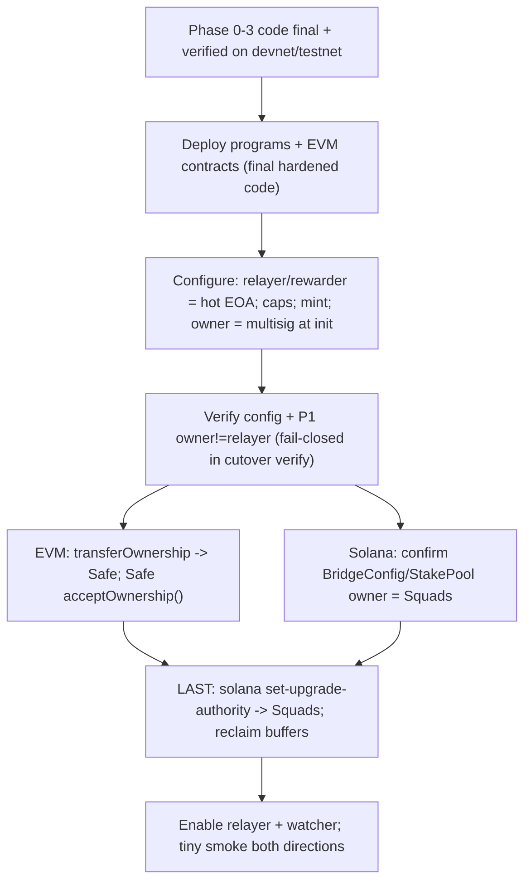

# Mainnet Cutover & Authority-Handoff Runbook — Bridge + Staking

Companion to [BRIDGE_STAKING_E2E_AUDIT.md](BRIDGE_STAKING_E2E_AUDIT.md). This is the
step-by-step procedure to deploy the NAVE bridge + staking to mainnet and hand
authority to the multisigs, in the order that respects the one irreversible
step. Execute it yourself: it needs the deploy keys and multisig signers.

## Owner addresses (fixed for mainnet)

- EVM Safe (`SAFE_ADDRESS`): `0xd338C8d0C3e28979D1cFec2f7C66769C796db89c` — owner of `NaveBridge`, `NaveStaking`, `WrappedNave` (and `NaveProtocol`/`PythOracle`) on Ethereum, Base, and Sepolia. Confirmed to have on-chain bytecode on all four chains.
- Solana Squads (`SQUADS_VAULT`): `4rSKUpKz41ToGr366Yv7Ca5ivfu6FUyhUDpsygR8UWmw` — program upgrade authority AND `BridgeConfig.owner` / `StakePool.owner`.
- Relayer / rewarder: the hot EOA (KMS/HSM-backed), **distinct** from the owners above. This separation is the gating audit finding (P1).

## The one irreversible step

The Solana program **upgrade authority** handoff (`solana program set-upgrade-authority` → `SQUADS_VAULT`) is effectively one-way: afterward, program bytecode changes require Squads approval. Everything else (EVM `transferOwnership`, Solana config `owner`) is a multisig-gated setter that can be re-pointed. Therefore all program code must be final and testnet-verified before deploy, and the upgrade-authority handoff runs LAST.



## Pre-flight (code state — done in this branch)

- [x] `nave_bridge` `ProcessedRelease` PDA seed includes `source_chain_id` (P6); all four off-chain derivations updated in lockstep.
- [x] `WrappedNave` two-step ownership (`pendingOwner` + `acceptOwnership`).
- [x] `NaveStaking.sweepDust` (owner-only, post-window) recovers rewardRate dust.
- [x] signer-service `bridgeWatcher.ts` + `retry_count` migration (deployed to Supabase) + `/bridge-queue` health endpoint.
- [x] Cutover scripts wire the bridge/staking/token ownership handoff and fail closed on `owner == relayer/rewarder` (P1).
- [x] Tests green: `forge test`, `cargo test --workspace`, signer-service `npm test`, both typechecks.

## Step 1 — Preflight (no state change)

```bash
# nave-app repo: env schema + bridge/staking safety gates (owner!=relayer, fee-bps parity, supplyCap<=custody).
npm run mainnet:preflight -- --env <mainnet.env>
```

Confirm in the env file: `SQUADS_VAULT`, `SAFE_ADDRESS`, `NAVE_BRIDGE_MAINNET_REVIEWED=true`, `BRIDGE_FEE_BPS=250` == `VITE_NAVE_BRIDGE_FEE_BPS=250` == on-chain (250, split 100/100/50), `BRIDGE_EVM_CONFIRMATIONS>=5`. Optionally set `BRIDGE_SOLANA_RELAYER_PUBKEY` / `BRIDGE_EVM_RELAYER_ADDRESS` so preflight also asserts owner≠relayer at config time.

## Step 2 — Deploy (Solana + EVM)

Solana (from `solana/`). Default scope is **bridge-stake only** (`nave_bridge` + `nave_staking`; treasury DAO programs stay on devnet). Pass `--scope full` when the DAO stack is ready:

```bash
npm run mainnet:cutover -- --env <env> --key-dir <secure> --phase deploy-contracts --scope bridge-stake --confirm-mainnet
```

EVM (per chain, from the contracts repo). Default scope deploys ONLY the hardened bridge stack (`DeployHardenedBridgeStack.s.sol` → `deployments/hardened-bridge-<chainId>.json`; on mainnet `STACK_OWNER` defaults to `SAFE_ADDRESS` as the *intended* final owner — the deploy wallet owns at deploy so minter/cap wiring can run, then `--phase handoff` proposes Safe ownership). Pass `--scope full` for the DAO stack on Ethereum/Base.

RPC: prefer per-chain `EVM_ETHEREUM_RPC_URL` / `EVM_BASE_RPC_URL` / `EVM_ROBINHOOD_RPC_URL`. The cutover auto-selects from `--chain-id` and **always** verifies `cast chain-id` matches before deploy (so a leftover Ethereum `EVM_RPC_URL` cannot broadcast Base/Robinhood onto L1). Canonical Ethereum stack is `hardened-bridge-1.json`; see `orphaned-ethereum-duplicate-stack.json` if a mistaken second L1 deploy exists.

```bash
npm run mainnet:cutover:evm -- --env <env> --chain-id 1    --phase deploy --scope bridge-stake --confirm-mainnet   # Ethereum
npm run mainnet:cutover:evm -- --env <env> --chain-id 8453 --phase deploy --scope bridge-stake --confirm-mainnet   # Base
npm run mainnet:cutover:evm -- --env <env> --chain-id 4663 --phase deploy --scope bridge-stake --confirm-mainnet   # Robinhood
```

## Step 3 — Configure (while deploy wallet is still the relevant authority)

- Solana `nave_bridge.initialize_config`: `owner = SQUADS_VAULT`, `relayer = <hot EOA pubkey>`, `protocol_fee_owner`, `staking_pool_owner = <collector owner>`, `fee_bps=250` split `100/100/50`, `per_tx_cap`, `daily_cap`. (Owner is set to Squads directly at init — no separate transfer needed.)
- Solana `nave_staking.initialize_pool`: `owner = SQUADS_VAULT` (seeds the 365-day drip).
- Create the neutral staking-fee collector; set `BRIDGE_SOLANA_STAKING_COLLECTOR == BRIDGE_SOLANA_STAKING_POOL_ACCOUNT`.
- EVM: set wNAVE `supplyCap` (non-zero; Σ across chains ≤ Solana custody), `setCaps` per-tx + daily on the lockbox, `setRewarder` = hot EOA on each `NaveStaking`. Confirm `WrappedNave.minter` = the lockbox.

## Step 4 — Verify (fail-closed P1 gate)

```bash
# Solana verify: asserts nave_bridge/nave_staking owner == Squads (or pending) AND owner != relayer.
npm run mainnet:cutover -- --env <env> --key-dir <secure> --phase verify --confirm-mainnet
# EVM verify (per chain): asserts bridge relayer/rewarder != Safe and records owner/pendingOwner.
npm run mainnet:cutover:evm -- --env <env> --chain-id 1    --phase verify --confirm-mainnet
npm run mainnet:cutover:evm -- --env <env> --chain-id 8453 --phase verify --confirm-mainnet
```

If verify throws a `P1 violation`, STOP and fix the owner/relayer separation before proceeding.

## Step 5 — EVM ownership handoff → Safe

```bash
# Proposes transferOwnership(SAFE) on NaveBridge, NaveStaking, WrappedNave (+ NaveProtocol/PythOracle).
npm run mainnet:cutover:evm -- --env <env> --chain-id 1    --phase handoff --confirm-mainnet
npm run mainnet:cutover:evm -- --env <env> --chain-id 8453 --phase handoff --confirm-mainnet
```

Then, from the **Safe** (all three contracts are two-step): call `acceptOwnership()` on `NaveBridge`, `NaveStaking`, `WrappedNave` on each chain. `PythOracle` is single-step (already moved). Re-run `--phase verify` and confirm `owner() == SAFE` everywhere.

## Step 6 — Solana ownership

`BridgeConfig.owner` / `StakePool.owner` are already the Squads vault (set at init in Step 3). No transfer needed; Step 4's Solana verify already asserted this. If you instead initialized with the deploy wallet, run `transfer_ownership(SQUADS_VAULT)` on both and have Squads `accept_ownership`, then re-verify.

## Step 7 — LAST: Solana program upgrade authority → Squads (irreversible)

```bash
npm run mainnet:cutover -- --env <env> --key-dir <secure> --phase handoff-authority --confirm-mainnet
```

This runs `solana program set-upgrade-authority <program> --new-upgrade-authority SQUADS_VAULT` for every program and verifies the new authority. After this, program upgrades require Squads. Then reclaim rent from any dangling deploy buffers:

```bash
bash scripts/reclaim-upgrade-buffers.sh            # list
bash scripts/reclaim-upgrade-buffers.sh --close-all # close buffers owned by your authority
```

## Step 8 — Enable + smoke

- Set `BRIDGE_RELAYER_ENABLED=true`, `STAKING_MIRROR_ENABLED=true`, `BRIDGE_WATCHER_ENABLED=true` on the signer worker (Node 22 image). Confirm the fee-bps drift check logs OK at startup.
- Execute a tiny real transfer in BOTH directions (Solana→EVM lock→mint, EVM→Solana burn→release); confirm exact fee split and that the recipient came from the on-chain event.
- Stake a small amount on each chain, confirm APY renders and a claim pays; confirm the mirror tick splits the collector.
- Monitor `/bridge-queue` for `stuck` transfers.

## Rollback / safety notes

- Before the Step 7 upgrade-authority handoff, a bad program can be re-upgraded in place by the deploy wallet (`upgrade-not-deploy`). After it, only Squads can upgrade — so do not run Step 7 until Steps 1–6 verify clean.
- `setPaused(true)` on the bridge (owner = multisig) is the emergency stop for both directions.
- The daily cap is a fixed 24h window (2× possible across the boundary) — size it accordingly (audit P3).
